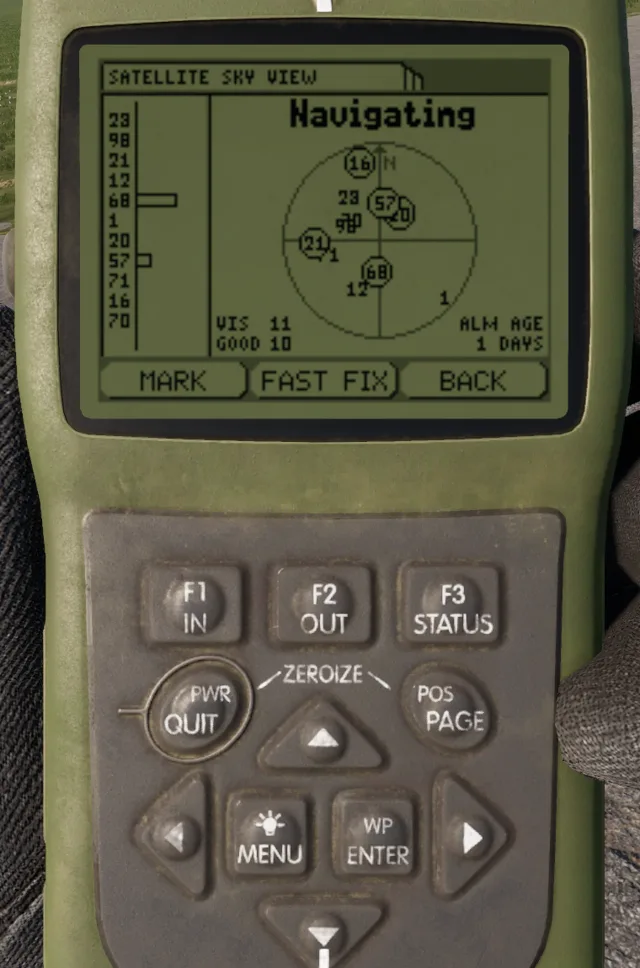
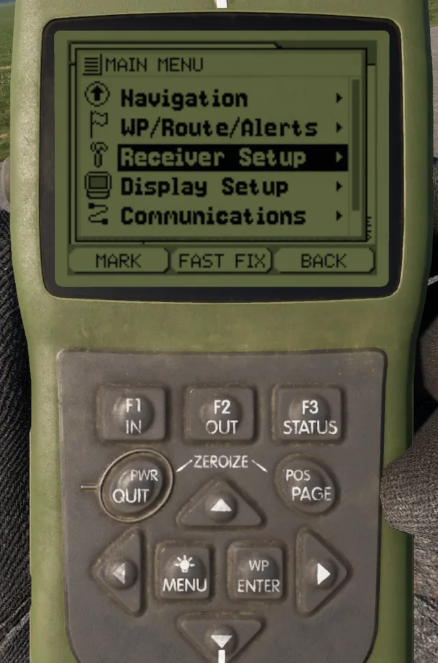
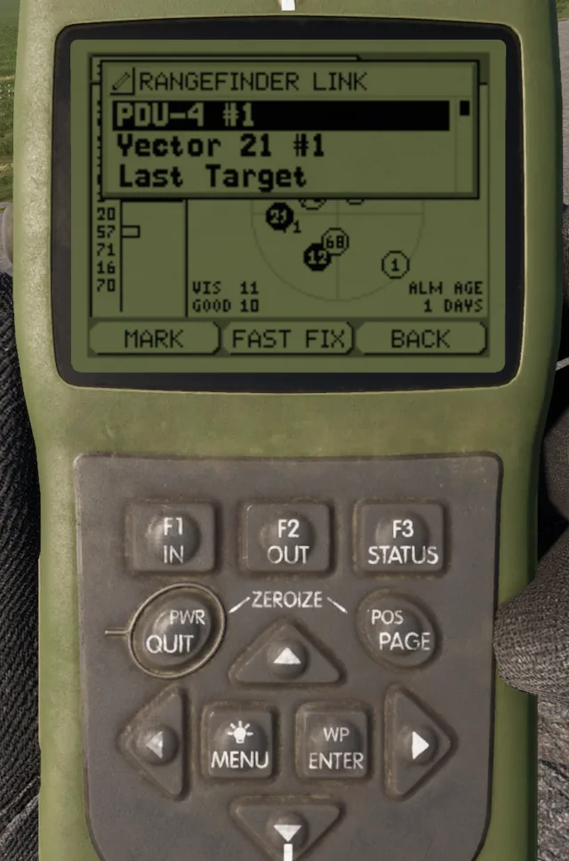
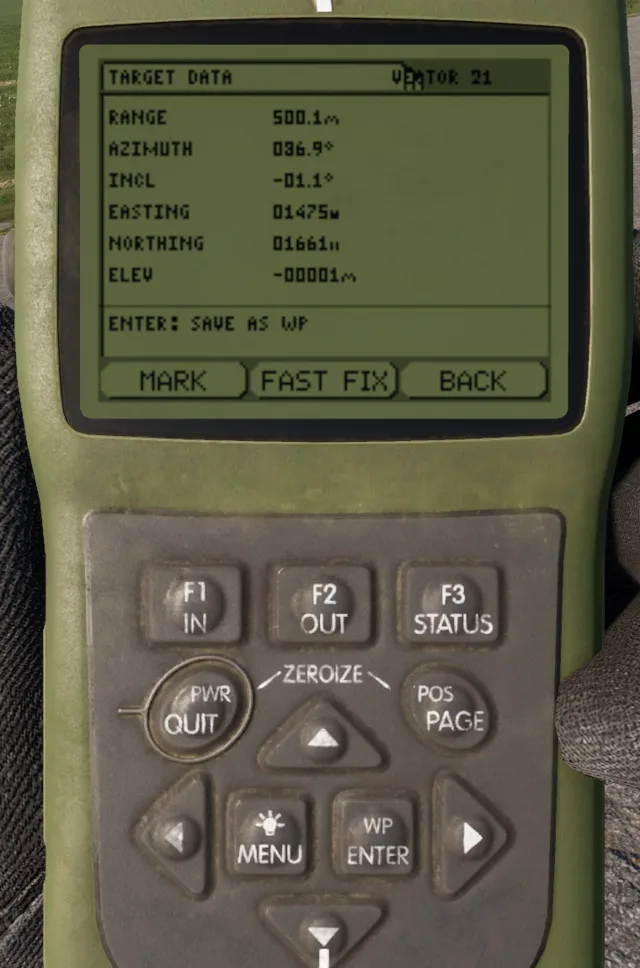
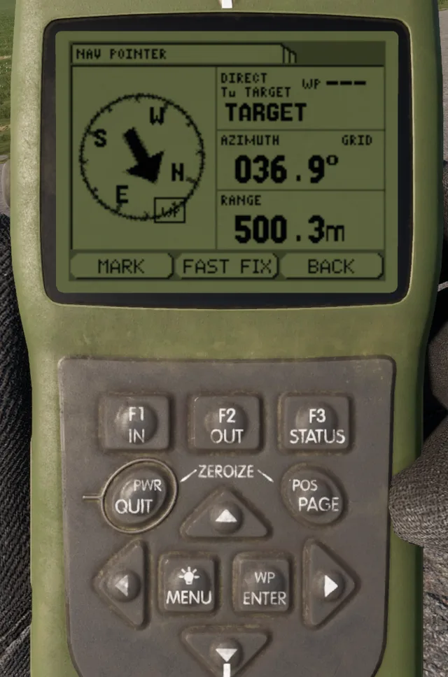
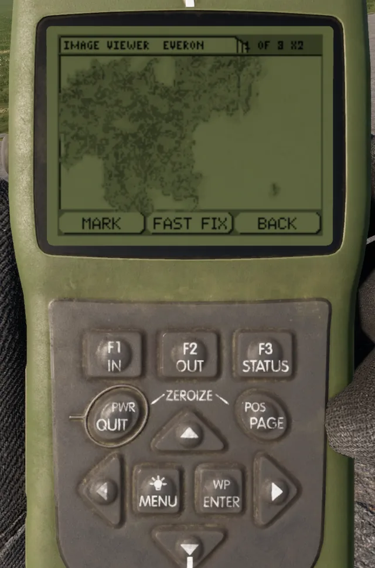

# AN/PSN-13 DAGR


Introduced in **0.5**


The AN/PSN-13 Defense Advanced GPS Receiver (DAGR) is the standard handheld GPS receiver of US forces. Use it to read your position, manage waypoints and routes, navigate, and receive target data from a laser rangefinder.

<figure><figcaption>
DAGR with the Present Position page
</figcaption></figure>

## Description

The DAGR has a monochrome screen and a keypad. The pages and menus follow the real device. The device keeps its state (waypoints, routes, active navigation, settings) when you put it away, and in the inventory.

The DAGR has these main functions:

* **Present Position**: grid, elevation, estimated horizontal error (EHE), ground speed, track, time and date.
* **Situational Awareness**: a map of the area with your position, the waypoints and the active route.
* **Nav Pointer**: a compass rose with an arrow, the azimuth and the range to the target of the navigation.
* **Satellite Sky View**: the satellites in view.
* **Waypoints and routes**: up to 15 routes, made of legs between waypoints.
* **Alerts**: an approach alert and an arrival alert during navigation.
* **Image Viewer**: raster maps of Everon, Arland and Kolguyev.
* **Rangefinder link**: receives the target from a linked Vector 21 or PDU-4.

## Usage

Put the DAGR in a quick slot and take it in your hand. Raise it to look at the screen. The keypad works only while you inspect the device.

| Keys | Action | Result |
| --- | --- | --- |
| **`E`** | ENTER | Selects the item. On the power-on page, acknowledges the warning. |
| **`Q`** | QUIT | Goes back one step. |
| **`F`** | MENU | Opens the page menu. Push again to open the main menu. |
| **`C`** | POS | Shows the next page: Present Position, Situational Awareness, Nav Pointer, Satellite Sky View. |
| **`W`** **`A`** **`S`** **`D`** | Arrows | Move the selection. On the Present Position page, **`W`** and **`S`** show the other pages. |
| **`1`** | F1 (IN) | Zooms in on the map. |
| **`2`** | F2 (OUT) | Zooms out on the map. |

You can also click the keys on the device with the mouse.

### Main menu

<figure><figcaption>
Main menu
</figcaption></figure>

The main menu has these entries:

* **Navigation**: Nav Pointer, Present Position, Sit Awareness, Satellite Sky View, Image Viewer, Stop Navigation.
* **WP/Route/Alerts**: Waypoints (WPs), Routes, Alerts.
* **Communications**: the rangefinder link.

### Navigate to a waypoint

1. Push **`F`** to open the main menu.
2. Select **WP/Route/Alerts**, then **Waypoints (WPs)**.
3. Select the waypoint.
4. Push **`F`** and select **Direct To WP**.
5. Push **`C`** until the Nav Pointer page shows.
6. Turn until the arrow points up. The page shows the azimuth and the range to the waypoint.

### Navigate a route

1. Open **WP/Route/Alerts > Routes**.
2. Push **`F`** and select **Create**, or select a route and **Edit**.
3. Add the legs. Each leg ends at a waypoint.
4. Set the alert radius (5 m to 250 m). The DAGR goes to the next leg inside this radius.
5. Push **`F`** and select **Navigate Route**.

The DAGR shows **ARRIVED** at the last waypoint. Use **Navigation > Stop Navigation** to stop.

### Alerts

Open **WP/Route/Alerts > Alerts** to set the alerts:

* **Approach Alert**: on or off.
* **Arrival Alert**: on or off.
* **Approach Dist**: the approach distance for direct navigation, 25 m to 1000 m (default 100 m).

An alert shows as a popup with a beep. Push **`E`** or **`Q`** to close it.

### Receive a target from a rangefinder

You can link the DAGR to a Vector 21 or a PDU-4 that you carry.

<figure><figcaption>
Rangefinder Link list
</figcaption></figure>

1. Put the rangefinder in your inventory.
2. On the DAGR, open the main menu and select **Communications**.
3. Select the rangefinder in the **RANGEFINDER LINK** list. The list shows **Linked** next to it.
4. Measure the range to a target with the rangefinder (**`R`**).
5. The DAGR beeps and shows the **TARGET DATA** page.

<figure><figcaption>
Target data from a Vector 21
</figcaption></figure>

The **TARGET DATA** page shows the range, azimuth, inclination, easting, northing, elevation and the source rangefinder. On this page:

* Push **`E`** to save the target as a waypoint (name **TGT###**).
* Push **`F`** and select **Go To Target** to navigate to the target. The Nav Pointer shows **To TARGET**.
* Use **Last Target** in the link list to show the last target again.
* Use **Disconnect** in the link list to remove the link.

<figure><figcaption>
Nav Pointer to the target
</figcaption></figure>


The link works only while the DAGR and the rangefinder are on the same character. If you drop or give away one of them, the target is not sent.


### Image Viewer

Open **Navigation > Image Viewer**.

* **`A`** and **`D`** show the previous and next image. When you zoom in, they move the image.
* **`W`** and **`S`** move the image up and down.
* **`E`** zooms in (x2, maximum x8). **`Q`** zooms out or closes the viewer.

<figure><figcaption>
Image Viewer, zoomed in
</figcaption></figure>

### Map view

If you have a map and a DAGR, push the globe button in the map toolbar. The map shows a copy of your DAGR with the current page, the navigation and the target data. See [Navigation and Positioning](../../general-systems/navigation-and-positioning.md).

## Specifications

| Category | Data |
| --- | --- |
| Weight | 0.5 kg |
| Faction | BLUFOR (US forces) |
| Routes | 15 |
| Route alert radius | 5 m to 250 m |
| Approach alert distance | 25 m to 1000 m |
| Linked rangefinders | Vector 21, PDU-4 |

## Related pages

* [Navigation and Positioning](../../general-systems/navigation-and-positioning.md)
* [Vector 21](vector-21.md)
* [PDU-4](../../redfor/gadgets/pdu-4.md)
* [14Ts8009 Orion](../../redfor/gadgets/orion.md)

## Prefabs


Use these prefabs in Workbench or in your own mission/mod.


| Prefab | Description |
| --- | --- |
| `{B1798B0F1258B765}Prefabs/Items/Equipment/Navigation/DAGR/DAGR.et` | DAGR |
| `{2C99C2B9A10C711D}Prefabs/Items/Equipment/Navigation/DAGR/DAGR_Map.et` | Copy of the DAGR for the map view, inherits DAGR |
