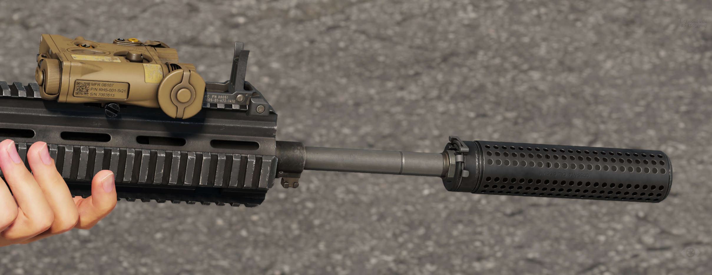

# KAC NT-4

<figure><figcaption></figcaption></figure>

Quick-detach 5.56×45mm suppressor that mounts to the M4QD or compatible muzzle devices.

## Specifications

| Category | Data |
| --- | --- |
| Name in game | NT4 Suppressor |
| Weight | 601 g |

## Variants

The item is available in these versions:

* NT4 Suppressor
* NT4 Suppressor (Cover) - Black
* NT4 Suppressor (Cover) - MCAM

## Prefabs


Use these prefabs in Workbench or in your own mission/mod.


| Prefab | Description |
| --- | --- |
| `{B9C41AAC90570E50}Prefabs/Weapons/Attachments/Muzzle/KAC_NT4_QDSS/KAC_NT4_QDSS.et` | NT4 Suppressor |
| `{EF8F44E10F9B7A9D}Prefabs/Weapons/Attachments/Muzzle/KAC_NT4_QDSS/KAC_NT4_QDSS_Covered.et` | NT4 Suppressor (Cover) - Black |
| `{B591C94754DB4893}Prefabs/Weapons/Attachments/Muzzle/KAC_NT4_QDSS/KAC_NT4_QDSS_Covered_Multicam.et` | NT4 Suppressor (Cover) - MCAM |
