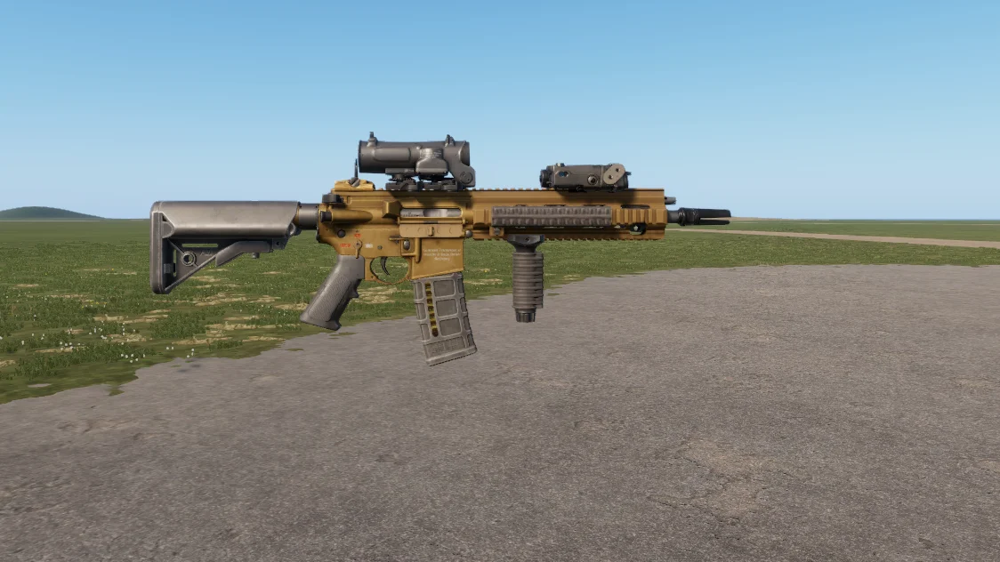

# HK416A5


First listed in the **0.15** changelog.


<figure><figcaption>
HK416A5, side view
</figcaption></figure>

5.56×45mm compact carbine. The HK416A5 is the latest generation of the HK416, using a short-stroke gas piston system in place of direct impingement for improved reliability. This 11-inch barrel configuration is favored by special operations forces for close-quarters use.

## Specifications

| Category | Data |
| --- | --- |
| Name in game | HK416A5 |
| Weight | 3 kg |
| Default magazine | 30Rnd STANAG Mag (M855A1/M856) |
| Rate of fire | 850 rounds/min |

## Prefabs


Use these prefabs in Workbench or in your own mission/mod.


| Prefab | Description |
| --- | --- |
| `{7C571F6F5A20A124}Prefabs/Weapons/Rifles/HK416A5/Rifle_HK416A5_Suppressed.et` | HK416A5 |
| `{353D39126E677470}Prefabs/Weapons/Rifles/HK416A5/Rifle_HK416A5_Var1.et` | HK416A5 |
| `{7C64E25D94F8003C}Prefabs/Weapons/Rifles/HK416A5/Rifle_HK416A5_base.et` | HK416A5 |
