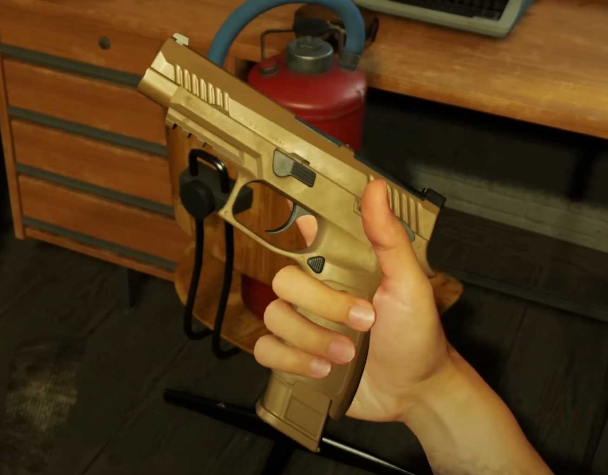

# M17 / M18


Was announced in Phase 1 trailer


<figure><figcaption></figcaption></figure>

9×19mm full-sized semi-automatic pistol. The M17 is the standard full-sized pistol of the United States Armed Forces, replacing the M9 in most branches.

## Specifications

| Category | Data |
| --- | --- |
| Name in game | M17 |
| Weight | 700 g |
| Default magazine | 17rnd M17/M18 Mag (M1152) |
| Rate of fire | 750 rounds/min |

## Prefabs


Use these prefabs in Workbench or in your own mission/mod.


| Prefab | Description |
| --- | --- |
| `{8069A3DF6410FDDF}Prefabs/Weapons/Handguns/M17/Handgun_M17.et` | Variant or base prefab |
| `{CB4D3F7152F83B15}Prefabs/Weapons/Handguns/M17/Handgun_M1718_base.et` | M17 |
| `{1F9DA556822C78DA}Prefabs/Weapons/Handguns/M17/Handgun_M18.et` | Variant or base prefab |
