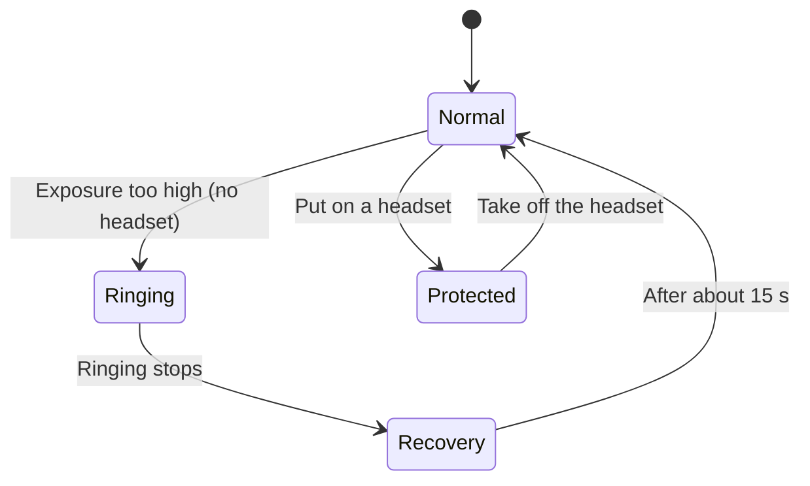

# Hearing Protection


Introduced in **0.17**


Active headsets protect your hearing from gunfire and explosions. The electronics amplify quiet sounds, such as steps and speech, and clamp down on loud sounds, such as shots. Without hearing protection, loud sounds cause ringing in the ears and muffled hearing.

<!-- TODO: screenshot of the hearing protection HUD indicator (bottom-right, headphones icon with level number) -->

## Requirements

You must wear one of these items:

* An active headset on its own, for example the CT-VI, Liberator II, Supreme Pro-X, Impact Sport or 6M2 headset.
* A headset attached to the headset slot of a helmet or hat.
* A helmet with an integrated headset, for example the Ops-Core with AMP, ECH HC, LShZ HC, Spartan, TBH or TOR helmets with a headset.

The system works only when you hear through a living character. On the respawn screen, as a spectator or in the Game Master camera, there is no hearing damage.

## How it works

The headset has 4 levels and an **Off** position. A new headset starts at level **2**.

| Level | Effect |
| --- | --- |
| Off | The ear cups attenuate all sounds (passive ear muffs). The world is quieter. |
| 1 to 4 | The electronics are on. Quiet sounds become louder, loud sounds are compressed. Each level increases the volume of the world. |

When the electronics are on, a limiter reacts to loud sounds. A shot or a blast lowers the volume immediately. The volume then comes back in approximately 0.35 s. The limiter reacts when the sound reaches you, so a distant shot has a delay (speed of sound, 343 m/s).

Without hearing protection, each loud sound adds to your noise exposure. The exposure decreases over time (half-life 45 s). When the exposure is too high:

1. Your ears ring for approximately 7 s.
2. All sounds become muffled.
3. Your hearing recovers in approximately 15 s.


The ringing obeys the **Tinnitus** setting in the game audio options. If you turn it off, you hear no ringing, but the muffled hearing stays.


## Usage

To change the level of your headset:

1. Put on a headset or a helmet with a headset.
2. Push **`End`**. The level goes to the next step: Off, 1, 2, 3, 4, then Off again.
3. Listen to the beeps. One beep is one level. A click means **Off**.

You can also set the level from the RHS radial menu. Select the headset, then select **Set level** and the level you want.

| Keys | Action | Result |
| --- | --- | --- |
| **`End`** | Cycle hearing protection level | The level goes to the next step and the headset beeps. |
| RHS radial menu | Set level | The headset goes to the selected level. |

The HUD indicator is at the bottom-right of the screen, above the weapon device indicator. It shows a headphones icon and the level number or **Off**. The indicator is grey when the electronics are off. It is bright for 3 s after a change, then it fades. It is hidden when you do not wear a headset.

You can change the key in **Settings > Keybinds**. See also [Default Key Bindings](default-key-binds.md).

## Configuration

Each headset prefab has an `RHS_HearingProtectionComponent`. Change these attributes in Workbench to make a different headset:

| Attribute | Default | Description |
| --- | --- | --- |
| `m_iLevelCount` | 4 | Number of amplification levels. |
| `m_iDefaultLevel` | 2 | Level when the headset is worn for the first time. 0 = Off. |
| `m_fPassiveVolume` | 0.3 | Volume of the world when the electronics are off. |
| `m_fMinLevelVolume` | 0.45 | Volume of the world at level 1. |
| `m_fMaxLevelVolume` | 1 | Volume of the world at the highest level. |
| `m_fLimiterThresholdDb` | 82 | Sound level in dB above which the limiter reacts. |
| `m_fLimiterFloor` | 0.15 | Lowest volume the limiter can go to. |
| `m_fLimiterRelease` | 0.35 | Time in seconds for the volume to come back after a loud sound. |
| `m_fDynamicRange` | -1.5 | Game dynamic range when the electronics are on. -1.5 = loud sounds -10.5 dB, quiet sounds +3.5 dB. |

## Known limitations

* The system is local to each player. Other players do not hear the change.
* Headsets with only a passive function (for example the CVC tanker helmet, the ZSh-7 pilot helmet and the TSh-4) do not give hearing protection.
* There is no flip-up position. A worn headset always protects.

## Related pages

* [3M™ PELTOR™ ComTac™ VI](../blufor/uniforms/helmets/3m-tm-peltor-tm-comtac-tm-vi.md)
* [RHS Radial Menu](radial-menu.md)
* [Default Key Bindings](default-key-binds.md)
* [Hearing Protection Headsets](../for-developers/hearing-protection-headsets.md) (for mod makers)

## Prefabs


Use these prefabs in Workbench or in your own mission/mod.


| Prefab | Description |
| --- | --- |
| `{1F49EEF2B889F0C1}Prefabs/Characters/HeadGear/Headphones_Peltor/Headphones_Peltor_base.et` | CT-VI headset, base |
| `{EB916F0BF524EF25}Prefabs/Characters/HeadGear/Headphones_Peltor/Headphones_Peltor_black.et` | CT-VI headset, black |
| `{6D6ADA201AD4E09B}Prefabs/Characters/HeadGear/Headphones_Peltor/Headphones_Peltor_olive.et` | CT-VI headset, olive |
| `{85D618A51C013F7A}Prefabs/Characters/HeadGear/Headphones_Peltor/Headphones_Peltor_yellow.et` | CT-VI headset, yellow |
| `{52BE66B6E343D441}Prefabs/Characters/HeadGear/Headphones_Impact/Headphones_Impact.et` | Impact Sport earmuffs, inherits CT-VI base |
| `{2162B5F1B9F5F6BB}Prefabs/Characters/HeadGear/Headphones_Sordin_Liberator/Headphones_Sordin_base.et` | Supreme Pro-X headset, base |
| `{63F1353AF0D18504}Prefabs/Characters/HeadGear/Headphones_Sordin_Liberator/Headphones_Sordin_black.et` | Supreme Pro-X headset, black |
| `{3FDA3C5B74681C25}Prefabs/Characters/HeadGear/Headphones_Sordin_Liberator/Headphones_liberator.et` | Liberator II TCI headset |
| `{F8554F236521F974}Prefabs/Characters/HeadGear/Headphones_6M2/headphones_6m2.et` | 6M2 (GSh-01) headset |
| `{150CBCB5E706F291}Prefabs/Characters/HeadGear/Headphones_6M2/Headphones_6M2-1.et` | 6M2-1 (GSh-01-01) headset |
| `{FE551345A4A69E3D}Prefabs/Characters/HeadGear/Hat_USMC_Boonie/Hat_USMC_Boonie_Comtac.et` | USMC boonie hat with CT-VI headset |
| `{7CA231DDB758BEAE}Prefabs/Characters/HeadGear/Hat_USMC_Boonie/Hat_USMC_Boonie_wd_Comtac.et` | USMC boonie hat with CT-VI headset, MARPAT woodland |

Helmets with an integrated headset (base prefabs, variants inherit)

| Prefab | Description |
| --- | --- |
| `{31DDB78459E84B5A}Prefabs/Characters/HeadGear/Helmet_ECH/Helmet_ECH_hc_v_r_l.et` | ECH-M Helmet HC (LB II) |
| `{C50D23658C5A6F86}Prefabs/Characters/HeadGear/Helmet_ECH/Helmet_ECH_hc_v_r_p.et` | ECH-M Helmet HC (CT-VI) |
| `{97C8979A8B09A870}Prefabs/Characters/HeadGear/Helmet_LShZ/Helmet_LShZ_HC_3M_atacs.et` | Helmet LShZ HC 3M atacs |
| `{D585D22578362515}Prefabs/Characters/HeadGear/Helmet_LShZ/Helmet_LShZ_HC_3M_black.et` | Helmet LShZ HC 3M black |
| `{39B0FB281A8CA301}Prefabs/Characters/HeadGear/Helmet_LShZ/Helmet_LShZ_HC_3M_emr.et` | Helmet LShZ HC 3M emr |
| `{2459B8B0FCB784C5}Prefabs/Characters/HeadGear/Helmet_LShZ/Helmet_LShZ_new_Blk_HC_Peltor.et` | Helmet LShZ new Blk HC Peltor |
| `{DB18850254AD9A37}Prefabs/Characters/HeadGear/Helmet_LShZ/Helmet_LShZ_new_Blk_HC_Sordin.et` | Helmet LShZ new Blk HC Sordin |
| `{0926450410F16E7A}Prefabs/Characters/HeadGear/Helmet_LShZ/Helmet_LShZ_new_OD_HC_Peltor.et` | Helmet LShZ new OD HC Peltor |
| `{F66778B6B8EB7088}Prefabs/Characters/HeadGear/Helmet_LShZ/Helmet_LShZ_new_OD_HC_Sordin.et` | Helmet LShZ new OD HC Sordin |
| `{AA281E75D1074806}Prefabs/Characters/HeadGear/Helmet_LShZ/variants/RGOlive/Helmet_LShZ_new_Blk_HC_Sordin_RGOlive.et` | Helmet LShZ new Blk HC Sordin RGOlive |
| `{CEE549AB5D10AD92}Prefabs/Characters/HeadGear/Helmet_OPSCORE/Helmet_OPSCORE_LBH_AOR1_Amp.et` | LBH Helmet (AMPS) - AOR1 |
| `{BE9D3BFE3682D196}Prefabs/Characters/HeadGear/Helmet_OPSCORE/Helmet_OPSCORE_LBH_AOR1_Liberator.et` | Helmet OPSCORE LBH AOR1 Liberator |
| `{FE5EDB072FF41187}Prefabs/Characters/HeadGear/Helmet_OPSCORE/Helmet_OPSCORE_LBH_AOR1_Peltor.et` | LBH Helmet (CT-VI) - AOR1 |
| `{7C320B4002B29E0A}Prefabs/Characters/HeadGear/Helmet_OPSCORE/Helmet_OPSCORE_LBH_AOR2_Amp.et` | LBH Helmet (AMPS) - AOR2 |
| `{C52A9FD1C91DF7B9}Prefabs/Characters/HeadGear/Helmet_OPSCORE/Helmet_OPSCORE_LBH_AOR2_Liberator.et` | Helmet OPSCORE LBH AOR2 Liberator |
| `{D47AFCA4D91A77A8}Prefabs/Characters/HeadGear/Helmet_OPSCORE/Helmet_OPSCORE_LBH_AOR2_Peltor.et` | LBH Helmet (CT-VI) - AOR2 |
| `{20FEE7AF45D6D123}Prefabs/Characters/HeadGear/Helmet_OPSCORE/Helmet_OPSCORE_MID_AMP.et` | Helmet OPSCORE MID AMP |
| `{48341E9725A44B11}Prefabs/Characters/HeadGear/Helmet_OPSCORE/Helmet_OPSCORE_MID_FG_AMP.et` | FAST XP Sentry Helmet (AMPS) - Foliage Green |
| `{8E35CFEB34D060AA}Prefabs/Characters/HeadGear/Helmet_OPSCORE/Helmet_OPSCORE_MID_GRAY_AMP.et` | FAST XP Sentry Helmet (AMPS) - Black |
| `{92405C6F3EA91DC8}Prefabs/Characters/HeadGear/Helmet_OPSCORE/Helmet_OPSCORE_MID_MC_AMP.et` | FAST XP Sentry Helmet (AMPS) - MCAM |
| `{E823D85FC3B32845}Prefabs/Characters/HeadGear/Helmet_OPSCORE/Helmet_OPSCORE_MT_AMP.et` | FAST MT Helmet (AMPS) - Urban Tan |
| `{97A2E60C473269E4}Prefabs/Characters/HeadGear/Helmet_OPSCORE/Helmet_OPSCORE_MT_Liberator.et` | Helmet OPSCORE MT Liberator |
| `{615BAA4C844855DD}Prefabs/Characters/HeadGear/Helmet_OPSCORE/Helmet_OPSCORE_MT_MARPAT_AMP.et` | FAST MT Helmet (AMPS) - AOR1 |
| `{13AD09FB14041481}Prefabs/Characters/HeadGear/Helmet_OPSCORE/Helmet_OPSCORE_MT_MARPAT_Liberator.et` | Helmet OPSCORE MT MARPAT Liberator |
| `{E3A3F457A1705C15}Prefabs/Characters/HeadGear/Helmet_OPSCORE/Helmet_OPSCORE_MT_MARPAT_PELTOR.et` | FAST MT Helmet (CT-VI) - AOR1 |
| `{D928AB10EAB641BC}Prefabs/Characters/HeadGear/Helmet_OPSCORE/Helmet_OPSCORE_MT_MC_AMP.et` | FAST MT Helmet (AMPS) - MCAM |
| `{F4EA5339BC3DA620}Prefabs/Characters/HeadGear/Helmet_OPSCORE/Helmet_OPSCORE_MT_MC_Liberator.et` | Helmet OPSCORE MT MC Liberator |
| `{7DD9CEADA6D3B92E}Prefabs/Characters/HeadGear/Helmet_OPSCORE/Helmet_OPSCORE_MT_MC_PELTOR.et` | FAST MT Helmet (CT-VI) - MCAM |
| `{E9BBF15608D735A7}Prefabs/Characters/HeadGear/Helmet_OPSCORE/Helmet_OPSCORE_MT_Peltor.et` | FAST MT Helmet (CT-VI) - Urban Tan |
| `{9AC01CB0720E1E9C}Prefabs/Characters/HeadGear/Helmet_OPSCORE/Helmet_OPSCORE_SF_Coy_AMP.et` | FAST SF Helmet (AMPS) - Tan |
| `{144F85C6489875B7}Prefabs/Characters/HeadGear/Helmet_OPSCORE/Helmet_OPSCORE_SF_Coy_Peltor.et` | FAST SF Helmet (CT-VI) - Tan |
| `{545A62848B160658}Prefabs/Characters/HeadGear/Helmet_OPSCORE/Helmet_OPSCORE_SF_Grey_Peltor.et` | FAST SF Helmet (CT-VI) - Gray |
| `{5E9930764CE81FF8}Prefabs/Characters/HeadGear/Helmet_OPSCORE/Helmet_OPSCORE_XP_AMP.et` | FAST XP Helmet (AMPS) - Urban Tan |
| `{4B11814B9B9BC84E}Prefabs/Characters/HeadGear/Helmet_OPSCORE/Helmet_OPSCORE_XP_Black_AMP.et` | FAST XP Helmet (AMPS) - Black |
| `{A770F24887D74E49}Prefabs/Characters/HeadGear/Helmet_OPSCORE/Helmet_OPSCORE_XP_Black_Liberator.et` | Helmet OPSCORE XP Black Liberator |
| `{6451FB59BAB301CA}Prefabs/Characters/HeadGear/Helmet_OPSCORE/Helmet_OPSCORE_XP_Black_PELTOR.et` | FAST XP Helmet (CT-VI) - Black |
| `{79125112CD4BC0C4}Prefabs/Characters/HeadGear/Helmet_OPSCORE/Helmet_OPSCORE_XP_FG_AMP.et` | FAST XP Helmet (AMPS) - Foliage Green |
| `{24916984EA94E6DA}Prefabs/Characters/HeadGear/Helmet_OPSCORE/Helmet_OPSCORE_XP_FG_Liberator.et` | Helmet OPSCORE XP FG Liberator |
| `{0C04EB95B5DFA2A8}Prefabs/Characters/HeadGear/Helmet_OPSCORE/Helmet_OPSCORE_XP_FG_PELTOR.et` | FAST XP Helmet (CT-VI) - Foliage Green |
| `{51858E5133158686}Prefabs/Characters/HeadGear/Helmet_OPSCORE/Helmet_OPSCORE_XP_Liberator.et` | Helmet OPSCORE XP Liberator |
| `{A36613EAD646961D}Prefabs/Characters/HeadGear/Helmet_OPSCORE/Helmet_OPSCORE_XP_MC_AMP.et` | FAST XP Helmet (AMPS) - MCAM |
| `{58DD402E6A25C776}Prefabs/Characters/HeadGear/Helmet_OPSCORE/Helmet_OPSCORE_XP_MC_Liberator.et` | Helmet OPSCORE XP MC Liberator |
| `{BBFEA6F0D2F4564C}Prefabs/Characters/HeadGear/Helmet_OPSCORE/Helmet_OPSCORE_XP_MC_PELTOR.et` | FAST XP Helmet (CT-VI) - MCAM |
| `{93F549AC3427E206}Prefabs/Characters/HeadGear/Helmet_OPSCORE/Helmet_OPSCORE_XP_PELTOR.et` | FAST XP Helmet (CT-VI) - Urban Tan |
| `{FDA7DCB260C871CF}Prefabs/Characters/HeadGear/Helmet_Spartan3/Helmet_Spartan3_FG_Peltor.et` | Spartan 3 Helmet (CT-VI) - ATACS-FG |
| `{02E6E100C8D26F3D}Prefabs/Characters/HeadGear/Helmet_Spartan3/Helmet_Spartan3_FG_Sordin.et` | Spartan 3 Helmet (Pro-X) - ATACS-FG |
| `{B51CAC65AFF99BD9}Prefabs/Characters/HeadGear/Helmet_Spartan3/Helmet_Spartan3_MC_Sordin.et` | Spartan 3 Helmet (Pro-X) - MCAM |
| `{522497DBEF2795E6}Prefabs/Characters/HeadGear/Helmet_Spartan3/Helmet_Spartan3_OD_Sordin.et` | Spartan 3 Helmet (Pro-X) - Olive |
| `{EAFC083A9167007B}Prefabs/Characters/HeadGear/Helmet_TBH3A/Helmet_TBH3A_HC_Liberator.et` | Helmet TBH3A HC Liberator |
| `{CBBC1B256EAFC4E9}Prefabs/Characters/HeadGear/Helmet_TBH3A/Helmet_TBH3A_HC_Peltor.et` | TBH-IIIA Helmet HC (CT-VI) - Tan |
| `{11A6FB2B62A8845B}Prefabs/Characters/HeadGear/Helmet_TOR/Helmet_TOR_medium_amp.et` | Tor M Helmet (AMPS) - Olive |
| `{0607207EE1A65815}Prefabs/Characters/HeadGear/Helmet_TOR/Helmet_TOR_small_green_peltor.et` | Tor S Helmet (CT-VI) - Olive |
| `{F9461DCC49BC46E7}Prefabs/Characters/HeadGear/Helmet_TOR/Helmet_TOR_small_green_sordin.et` | Tor S Helmet (Pro-X) - Olive |
| `{C67B6FED199A1163}Prefabs/Characters/HeadGear/Helmet_TOR/Helmet_TOR_small_peltor_black.et` | Tor S Helmet (CT-VI) - Black |
| `{79CC1DB67F1C8FCF}Prefabs/Characters/HeadGear/Helmet_TOR/Helmet_TOR_small_sordin_black.et` | Tor S Helmet (Pro-X) - Black |
| `{1CB7F72BBD5E2972}Prefabs/Characters/HeadGear/Helmet_TOR2/Helmet_TOR2M_AMP_olive.et` | Tor-2 Helmet M (AMPS) - Olive |

