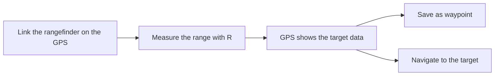

# Navigation and Positioning

The mod contains devices that show your position and help you navigate on the map. There are hand-held GPS receivers and digital watches.

All devices show your coordinates. The hand-held receivers also manage waypoints and routes, give navigation to a point, and receive target data from a laser rangefinder.

## Hand-held devices

| Device | Faction | Interface |
| --- | --- | --- |
| [AN/PSN-13 DAGR](../blufor/gadgets/dagr.md) | BLUFOR | English, monochrome screen |
| [14Ts8009 Orion](../redfor/gadgets/orion.md) | REDFOR | Russian, colour screen |

Put the device in a quick slot and take it in your hand. Raise it and inspect it to use the keypad. You can also click the keys on the device with the mouse. Go to the page of each device for the keys and the menus.

<figure><figcaption></figcaption></figure>

<figure><figcaption>
DAGR in OFF mode
</figcaption></figure>

<figure><figcaption>
DAGR displaying position and elevation
</figcaption></figure>

### Functions

The DAGR and the Orion have the same functions:

| Function | Description |
| --- | --- |
| Position | Grid, elevation, speed, track and position error. |
| Waypoints | Make, edit and delete waypoints. The waypoints stay in the device. |
| Direct navigation | Navigate to a waypoint, a point on the map or a target. The device shows the azimuth and the range. |
| Routes | Up to 15 routes with legs between waypoints. The device goes to the next leg when you are near the waypoint. |
| Alerts | An approach alert and an arrival alert, with a beep. |
| Rangefinder link | Receives the target from a linked [Vector 21](../blufor/gadgets/vector-21.md) or [PDU-4](../redfor/gadgets/pdu-4.md). |
| Images | Raster maps of Everon, Arland and Kolguyev. |

The device keeps its state when you put it away. The waypoints, the routes, the active navigation and the settings stay with the device, also when you give it to another player.

### Rangefinder link

You can send a laser measurement from a rangefinder to the GPS receiver. Both devices can link to either rangefinder.

1. Carry the GPS receiver and the rangefinder on the same character.
2. On the GPS receiver, select the rangefinder in the link list (DAGR: **Communications**, Orion: **ПРИКЛАДНЫЕ > ДАЛЬНОМЕР**).
3. Measure the range to the target with the rangefinder.
4. The GPS receiver beeps and shows the target data: range, azimuth, inclination, coordinates, elevation and the source.
5. Save the target as a waypoint, or start the navigation to the target.

### Map view

If you have a map and a hand-held device, push the globe button in the map toolbar. The map shows a copy of your device.

The copy shows the live state of the device: your position, the waypoints, the active navigation and the last target data. The status pages, the navigation pages and the target data page stay open in the map view. Menus and edit pages do not show in the map view.

<figure><figcaption>
DAGR in map view
</figcaption></figure>

<figure><figcaption>
Orion in map view
</figcaption></figure>


If you carry more than one GPS receiver, the map view shows the first device that it finds. This is not always the device that you used last.


## Digital watches

Some digital watches, for example the [Garmin Tactix Bravo](garmin-tactix-bravo.md), also have navigation functions. Put the watch in the watch slot to wear it on your wrist.

<figure><figcaption>
Garmin on the wrist
</figcaption></figure>

Put the watch in a quick slot and inspect it to change the mode.

<figure><figcaption>
Inspection of Garmin
</figcaption></figure>

Use **Switch Mode** to show the information that you need.

<figure><figcaption>
Garmin positioning
</figcaption></figure>

<figure><figcaption>
Garmin compass
</figcaption></figure>

The watch keeps the selected mode when you remove it from the quick slot.

<figure><figcaption></figcaption></figure>

## Related pages

* [AN/PSN-13 DAGR](../blufor/gadgets/dagr.md)
* [14Ts8009 Orion](../redfor/gadgets/orion.md)
* [Vector 21](../blufor/gadgets/vector-21.md)
* [PDU-4](../redfor/gadgets/pdu-4.md)
* [Garmin Tactix Bravo](garmin-tactix-bravo.md)
