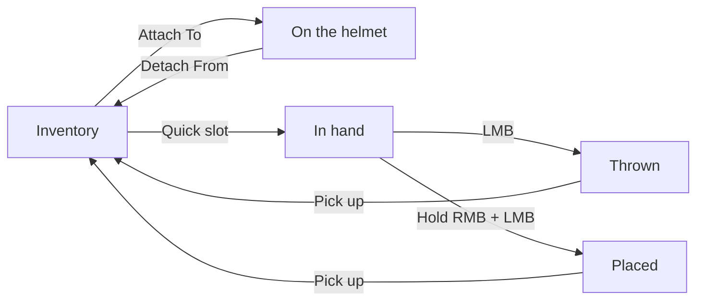

# Strobe Devices

Strobe marker lights show the position of a soldier, a vehicle or a point at night. Most of them flash in infrared (IR), so only night vision devices see them. You can wear a strobe on the helmet, hold it, throw it or place it on a surface.

<!-- TODO: screenshot of a strobe on a helmet, seen through night vision -->

## Requirements

You need one of these strobes:

| Strobe | Weight | Light |
| --- | --- | --- |
| HEL-STAR 6 Strobe Marker Light | 65 g | IR strobe (2 modes), visible green, visible red |
| MS2000 (M2) Strobe Marker Light | 104 g | IR strobe with the visible light filter, visible strobe without the filter |
| VIP Strobe Marker Light | 112 g | IR strobe |

To see an IR strobe, use a night vision device, for example the [AN/PVS-14](../blufor/gadgets/an-pvs-14.md). See also [RHS IR, NV and "Thermals"](rhs-ir-and-nv.md).

## How it works

A strobe can be in four places. You control the light in each place:

The strobe keeps its mode and its on/off state when it moves from one place to another.

## Usage

### Wear a strobe on the helmet

1. Open the inventory.
2. Select the strobe and select **Attach To** to put it on the velcro of your helmet.
3. Open the [RHS Radial Menu](radial-menu.md) to turn the strobe on or off and to change the mode.

Use **Detach From** to remove the strobe, or **Replace With** to change it for another item.


Some helmets come with a strobe already attached.


### Hold a strobe

1. Put the strobe in a quick slot.
2. Select the quick slot. You hold the strobe like a grenade.
3. Open the [RHS Radial Menu](radial-menu.md) to turn the strobe on or off and to change the mode.

### Throw a strobe

1. Hold the strobe in your hand.
2. Turn the strobe on.
3. Push the left mouse button (**`LMB`**) to throw it, like a grenade.

When the strobe stops on the ground, you can pick it up again after approximately 1 s.

### Place a strobe

1. Hold the strobe in your hand.
2. Push and hold the right mouse button (**`RMB`**). A preview shows where the strobe goes.
3. Aim at a wall, the ground or a vehicle, not more than 1.4 m away.
4. Push the left mouse button (**`LMB`**) to place the strobe.

The strobe sticks to the surface with the light away from it. A strobe on a vehicle moves with the vehicle.

### Control a thrown or placed strobe

Look at the strobe and use the action menu:

* **Turn ON** / turn off.
* Change the mode (HEL-STAR 6 and MS2000).
* **Pick up** the strobe.

| Keys | Action | Result |
| --- | --- | --- |
| **`LMB`** | Throw | The strobe is thrown like a grenade. |
| Hold **`RMB`** + **`LMB`** | Place | The strobe is placed on the surface. |
| Gamepad: hold **`LT`** | Place mode | Shows the placement preview. |
| RHS radial menu | Power and mode | Turns the strobe on or off, or changes the mode (on the helmet or in hand). |

### Modes

HEL-STAR 6

| Mode | Light |
| --- | --- |
| Mode A1 | Visible green |
| Mode A2 | Visible red |
| Mode B1 | IR strobe, short cycle |
| Mode B2 | IR strobe, long cycle |

<!-- TODO: confirm if the visible green and red modes flash or stay on -->

MS2000

| Action | Light |
| --- | --- |
| Put on visible light filter | IR strobe (default) |
| Remove visible light filter | Visible strobe |

The VIP strobe has only the IR strobe.


A visible strobe can show your position to the enemy without night vision. Use the IR modes when you do not want to be seen.


## Configuration

Each throwable strobe has an `RHS_ThrowablePlaceableItemComponent`. Change these attributes in Workbench:

| Attribute | Default | Description |
| --- | --- | --- |
| `m_bRequireAimToPlace` | 1 | Show the placement preview only while you hold **`RMB`**. Otherwise the item is thrown. |
| `m_bAlignForwardToSurfaceNormal` | 1 | Place the item with its front (local Z axis) away from the surface. |
| `m_bPickableAfterThrow` | 1 | Replace a thrown item with a normal item when it stops, so you can pick it up. |
| `m_bSkipPlacementAnimation` | 1 | Place the item without the placing animation. |

## Known limitations

* The placing has no animation. Grenade animation sets have no placing animation.
* Other strobe lights (for example on some helmet counterweights and the V-Lite) are fixed on the helmet. You cannot throw or place them.

## Related pages

* [RHS Radial Menu](radial-menu.md)
* [RHS IR, NV and "Thermals"](rhs-ir-and-nv.md)
* [RHS Extended Inventory System](rhs-extended-inventory-system.md)
* [Throwable and Placeable Items](../for-developers/throwable-and-placeable-items.md) (for mod makers)

## Prefabs


Use these prefabs in Workbench or in your own mission/mod.


| Prefab | Description |
| --- | --- |
| `{5F7EF7FEBC39B874}Prefabs/Items/Equipment/Nightvision/HelstarStrobe/Helstar.et` | HEL-STAR 6 strobe, inherits vanilla `Throw_Base.et` |
| `{643AB339663E92F7}Prefabs/Items/Equipment/Nightvision/MS2000/Marker_MS2000.et` | MS2000 strobe, inherits vanilla `Throw_Base.et` |
| `{8F54EE49D3317266}Prefabs/Items/Equipment/Nightvision/VipLight/VipLight.et` | VIP strobe, inherits vanilla `Throw_Base.et` |
