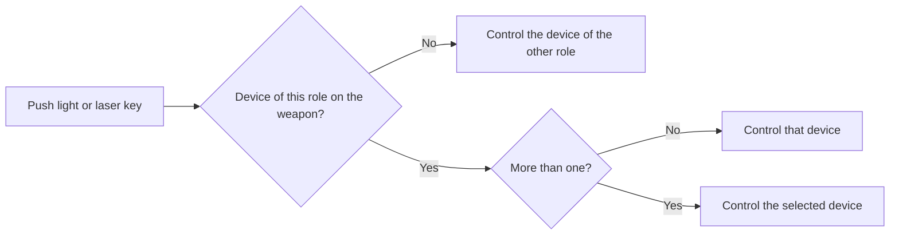

# Weapon Light and Laser Devices

Weapon lights and laser devices have their own keys. One key group controls the lights and one key group controls the lasers. If a weapon has more than one device of the same type, you select which one the keys control. A small indicator on the screen shows the devices and their state.

<!-- TODO: screenshot of the weapon device indicator on the HUD -->

## Requirements

You need a weapon with one or more of these attachments:

* A weapon light, for example the M300C.
* A laser or a laser/illuminator device, for example the AN/PEQ-15, AN/PEQ-16A, AN/PSQ-23, PERST-3 or LTsU-A.

See [RHS IR, NV and "Thermals"](rhs-ir-and-nv.md) for the IR lasers and illuminators.

## How it works

Each device on the weapon has a role: **light** or **laser**.

* AN/PEQ-15, AN/PEQ-16, PERST, AN/PSQ-23 (MBS) and LTsU-A are **lasers**.
* All other weapon lights are **lights**.

One key press controls only one device:

1. The key goes to the device of its own role.
2. If there are two or more devices of that role, the key goes to the selected device. Use the select key to change it.
3. If the weapon has no device of that role, the key controls the device of the other role.

## Usage

| Keys | Action | Result |
| --- | --- | --- |
| **`=`** | Toggle light | Turns the light on or off. |
| **`=`** two times | Light mode | Changes the mode of the light. |
| Hold **`=`** | Momentary light | The light is on while you hold the key. |
| **`-`** | Toggle laser | Turns the laser on or off. |
| **`-`** two times | Laser mode | Changes the mode of the laser, for example visible or IR. |
| Hold **`-`** | Momentary laser | The laser is on while you hold the key. |
| **`]`** | Select device | Selects the next device of the same role. Works only with two or more devices of one role. |

### Gamepad

| Buttons | Action |
| --- | --- |
| Hold **`Y`** + D-pad left, two times | Toggle light |
| Hold **`Y`** + D-pad right, two times | Light mode |
| Hold D-pad left | Momentary light |
| Hold **`Y`** + D-pad left, one time | Toggle laser |
| Hold **`Y`** + D-pad right, one time | Laser mode |
| Hold D-pad right | Momentary laser |
| Hold **`Y`** + D-pad up | Select device |

You can change all keys in **Settings > Keybinds**, in the **RHS** category.

### Indicator

The indicator is at the bottom-right of the screen, above the [Hearing Protection](hearing-protection.md) indicator:

* It shows one row for the light and one row for the laser, with the name of the device.
* **(1/2)** shows which device is selected when there are two devices of the same role.
* White means on. Grey means off.
* The indicator is bright for 3 s after a change, then it fades.

## Known limitations

* The keys work only for the weapon in your hands.
* Devices on the helmet, for example the NVG illuminator, use their own keys. See [Default Key Bindings](default-key-binds.md).

## Related pages

* [Default Key Bindings](default-key-binds.md)
* [RHS IR, NV and "Thermals"](rhs-ir-and-nv.md)
* [RHS Radial Menu](radial-menu.md)
