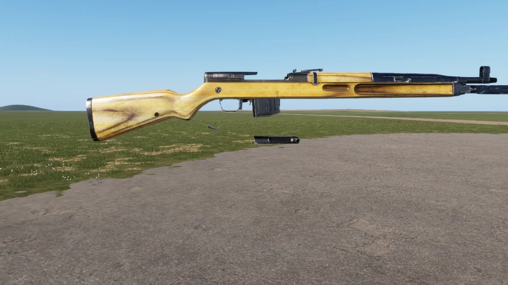

# vz. 52

<!-- TODO: confirm the version that introduced this asset -->

<figure><figcaption>
vz. 52, side view
</figcaption></figure>

7.62×45mm semi-automatic battle rifle. The vz. 52 is a Czechoslovakian self-loading rifle developed shortly after the Second World War and has been used in conflicts around the globe.

## Specifications

| Category | Data |
| --- | --- |
| Name in game | vz. 52 |
| Weight | 3.75 kg |

## Prefabs


Use these prefabs in Workbench or in your own mission/mod.


| Prefab | Description |
| --- | --- |
| `{96A2309CE280198F}Prefabs/Weapons/Rifles/Vz52/Rifle_Vz52.et` | vz. 52 |
| `{211E104BCAB8C7DA}Prefabs/Weapons/Rifles/Vz52/Rifle_Vz52_base.et` | vz. 52 |
