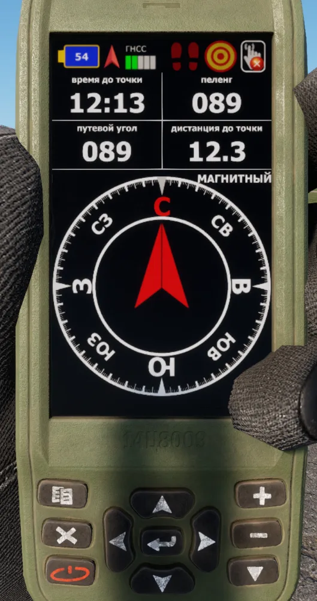
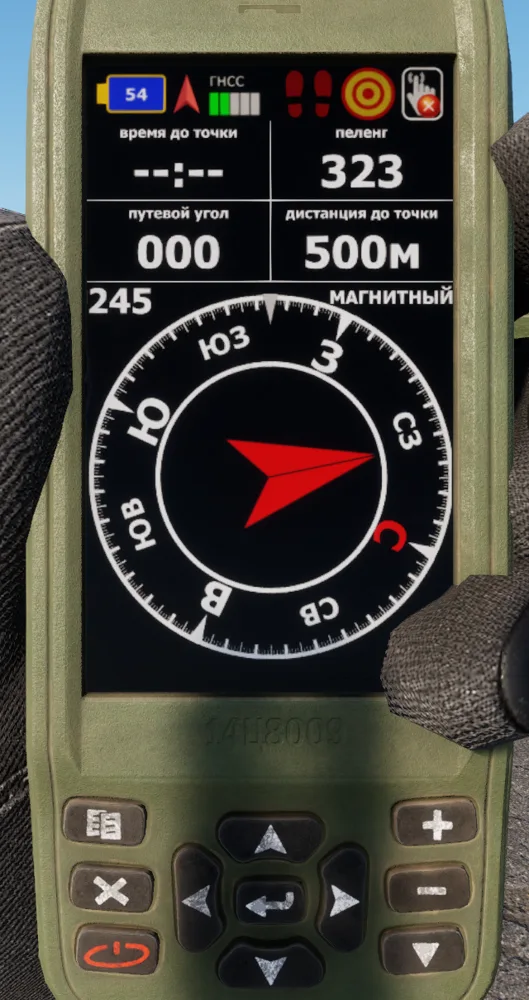
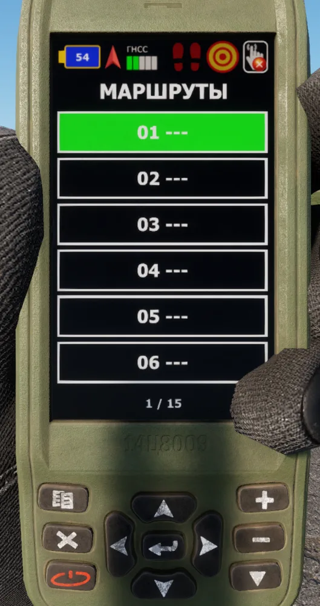
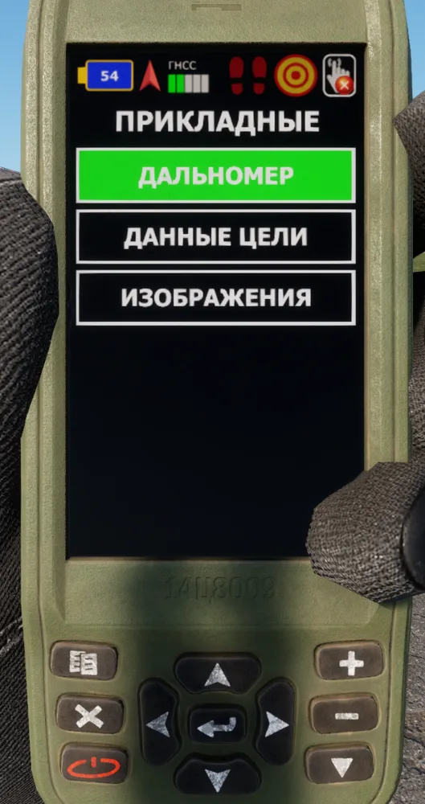
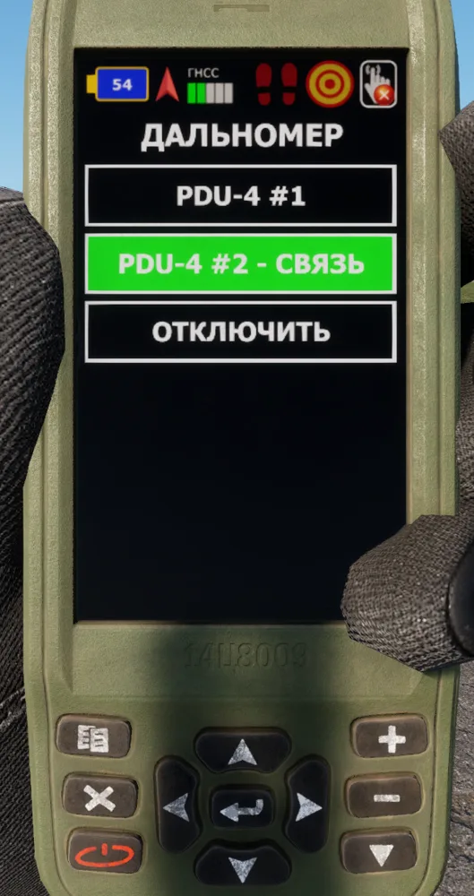
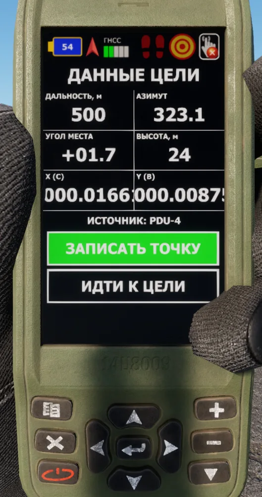

# 14Ts8009 Orion


Introduced in **0.6**


The 14Ts8009 "Orion" is a Russian handheld navigation receiver for the GLONASS and GPS satellite systems. Use it to read your position, manage waypoints and routes, navigate, and receive target data from a laser rangefinder.

<figure><figcaption>
Orion with the solution page
</figcaption></figure>

## Description

The Orion has a colour screen and a keypad. The interface is in Russian. The device keeps its state (waypoints, routes, active navigation, settings) when you put it away, and in the inventory.

The Orion has these main pages:

* **Solution** page: your position, height, speed, track and the position error (СКО).
* **Compass** page: time, bearing, track and distance to the target of the navigation, with an arrow.
* **Map** (КАРТЫ): a map with your position, the waypoints and a line to the target.
* **Main menu**: navigation, maps, satellites, applications and settings.

## Usage

Put the Orion in a quick slot and take it in your hand. Raise it to look at the screen. The keypad works only while you inspect the device.

| Keys | Action | Result |
| --- | --- | --- |
| **`Q`** | Menu key | Shows the next page: solution, compass, main menu, map. |
| **`E`** | Enter | Selects the item. |
| **`Z`** | Quit (✕) | Goes back one step. |
| **`W`** **`A`** **`S`** **`D`** | Arrows | Move the selection. |
| **`1`** | Plus (+) | Zooms in. |
| **`2`** | Minus (−) | Zooms out. |
| **`C`** | Arrow | On the map, centres the map on your position. |

You can also click the keys on the device with the mouse.

### Main menu

The main menu has these entries:

| Entry | Translation | Content |
| --- | --- | --- |
| НАВИГАЦИЯ | Navigation | ТОЧКИ (waypoints), МАРШРУТЫ (routes), ОСТАНОВИТЬ (stop navigation). |
| КАРТЫ | Maps | The map page. |
| СПУТНИКИ | Satellites | The satellites in view. |
| ПРИКЛАДНЫЕ | Applications | ДАЛЬНОМЕР (rangefinder link), ДАННЫЕ ЦЕЛИ (target data), ИЗОБРАЖЕНИЯ (images). |
| НАСТРОЙКИ | Settings | Alert settings (ОПОВЕЩЕНИЯ). |

### Make a waypoint

1. Open **НАВИГАЦИЯ > ТОЧКИ > <НОВАЯ>**.
2. Select a method:
   * **ПО АЗИМУТУ**: azimuth and distance from your position.
   * **ПО КООРДИНАТАМ**: coordinates.
   * **С КАРТЫ**: a point on the map.
3. Set the name and the data, then save the waypoint.

### Navigate to a waypoint

1. Push **`Q`** until the map shows.
2. Select the waypoint.
3. Select **ИДТИ** (go). The map shows a line to the waypoint.
4. Push **`Q`** until the compass page shows. The arrow points to the waypoint.

You can also move the map cursor to a point and push **`E`** to navigate to that point.

<figure><figcaption>
Compass page during navigation
</figcaption></figure>

### Navigate a route

<figure><figcaption>
Route menu
</figcaption></figure>

1. Open **НАВИГАЦИЯ > МАРШРУТЫ**. There are 15 routes.
2. Select a route.
3. Select **ТОЧКИ МАРШРУТА** (route points) and add the waypoints. You can also replace (**ЗАМЕНИТЬ**) or delete (**УДАЛИТЬ**) a point.
4. Select **ИДТИ ПО МАРШРУТУ** (follow the route).

You can also rename the route (**ПЕРЕИМЕНОВАТЬ**), read its length, or delete it. To stop the navigation, select **НАВИГАЦИЯ > ОСТАНОВИТЬ**.

### Alerts

Open **НАСТРОЙКИ** to set the alerts (ОПОВЕЩЕНИЯ):

* **ПОДХОД**: the approach alert, on (**ВКЛ**) or off (**ВЫКЛ**).
* **ПРИБЫТИЕ**: the arrival alert, on or off.
* **ДИСТ.**: the approach distance. Select it to go to the next value.

An alert shows as a popup (**ОПОВЕЩЕНИЕ**) with a beep. Push **`E`** or **`Z`** to close it.

### Receive a target from a rangefinder

You can link the Orion to a PDU-4 or a Vector 21 that you carry.

<figure><figcaption>
Applications menu (ПРИКЛАДНЫЕ)
</figcaption></figure>

1. Put the rangefinder in your inventory.
2. On the Orion, open **ПРИКЛАДНЫЕ > ДАЛЬНОМЕР**.
3. Select the rangefinder. The list shows **- СВЯЗЬ** (linked) next to it.
4. Measure the range to a target with the rangefinder (**`R`**).
5. The Orion beeps and shows the **ДАННЫЕ ЦЕЛИ** (target data) page.

<figure><figcaption>
PDU-4 linked
</figcaption></figure>

The target data page shows the range, azimuth, elevation angle (УГОЛ МЕСТА), height, X and Y coordinates and the source rangefinder. On this page:

* Select **ЗАПИСАТЬ ТОЧКУ** to save the target as a waypoint (name **ЦЕЛЬ-nn**).
* Select **ИДТИ К ЦЕЛИ** to navigate to the target. The compass page opens.
* Open **ПРИКЛАДНЫЕ > ДАННЫЕ ЦЕЛИ** to show the last target again.
* Select **ОТКЛЮЧИТЬ** in the rangefinder list to remove the link.

<figure><figcaption>
Target data from a PDU-4
</figcaption></figure>


The link works only while the Orion and the rangefinder are on the same character. If you drop or give away one of them, the target is not sent.


### Images

Open **ПРИКЛАДНЫЕ > ИЗОБРАЖЕНИЯ** to show raster maps of Everon, Arland and Kolguyev.

* **`A`** and **`D`** show the previous and next image. When you zoom in, they move the image.
* **`W`** and **`S`** move the image up and down.
* **`1`** zooms in, **`2`** zooms out, **`E`** fits the image to the screen.

### Map view

If you have a map and an Orion, push the globe button in the map toolbar. The map shows a copy of your Orion with the solution, compass, map or target data page. See [Navigation and Positioning](../../general-systems/navigation-and-positioning.md).

## Specifications

| Category | Data |
| --- | --- |
| Weight | 0.5 kg |
| Faction | REDFOR (Russian forces) |
| Routes | 15 |
| Linked rangefinders | PDU-4, Vector 21 |

## Known limitations

* These buttons have no function at this time: ТРЕКИ (tracks), СБР.ОДОМЕТРА and СБР.СР.СКОР. (resets), СЛУЖЕБНЫЕ (service) and СИСТЕМА (system).
* The satellite list is a simulation. It is not the same as the DAGR sky view.

## Related pages

* [Navigation and Positioning](../../general-systems/navigation-and-positioning.md)
* [PDU-4](pdu-4.md)
* [Vector 21](../../blufor/gadgets/vector-21.md)
* [AN/PSN-13 DAGR](../../blufor/gadgets/dagr.md)

## Prefabs


Use these prefabs in Workbench or in your own mission/mod.


| Prefab | Description |
| --- | --- |
| `{A55A815F28739FEC}Prefabs/Items/Equipment/Navigation/Orion/Orion.et` | Orion |
| `{C354CB40B3928AC0}Prefabs/Items/Equipment/Navigation/Orion/Orion_Map.et` | Copy of the Orion for the map view, inherits Orion |
