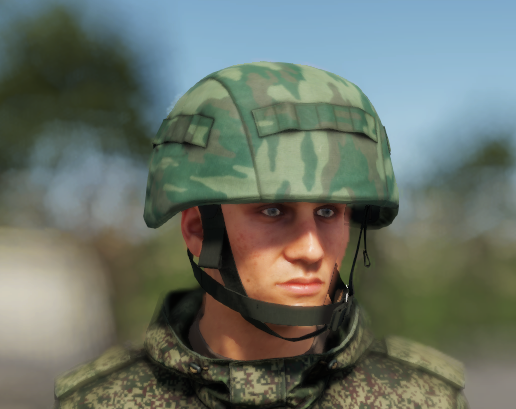

# 6B7-1M


Introduced in **0.2.414**


<figure><figcaption>
6B7-1M in Flora camo
</figcaption></figure>

The helmet is compatible with the [rhs-extended-inventory-system.md](../../../general-systems/rhs-extended-inventory-system.md "mention")and can mount headsets and other face accessories.

## Specifications

| Category | Data |
| --- | --- |
| Name in game | 6B7 Helmet Cover - EMR |
| Weight | 170 g |
| Faction | Russian forces (REDFOR) |

## Variants

The item is available in these versions:

* 6B7 Helmet Cover - EMR
* 6B7 Helmet Cover - Flora
* 6B7 Helmet Cover - Olive
* 6B7-1M Helmet

## Prefabs


Use these prefabs in Workbench or in your own mission/mod.


| Prefab | Description |
| --- | --- |
| `{D2733A64E75E8D26}Prefabs/Characters/HeadGear/Helmet_6B7/Headgear_6b7_cover_base.et` | 6B7 Helmet Cover - EMR |
| `{6C1D973D175BA611}Prefabs/Characters/HeadGear/Helmet_6B7/Headgear_6b7_cover_emr.et` | 6B7 Helmet Cover - EMR |
| `{F92521EA77884768}Prefabs/Characters/HeadGear/Helmet_6B7/Headgear_6b7_cover_flora.et` | 6B7 Helmet Cover - Flora |
| `{5079CFD1DE0A1741}Prefabs/Characters/HeadGear/Helmet_6B7/Headgear_6b7_cover_olive.et` | 6B7 Helmet Cover - Olive |
| `{58A12E4317DFAA23}Prefabs/Characters/HeadGear/Helmet_6B7/Helmet_6B7.et` | 6B7-1M Helmet |
| `{3C2C345310D0CD01}Prefabs/Characters/HeadGear/Helmet_6B7/Helmet_6B7_Flora.et` | 6B7-1M Helmet |
| `{B8B7CB8DE9BD2B32}Prefabs/Characters/HeadGear/Helmet_6B7/Helmet_6B7_base.et` | 6B7-1M Helmet |
