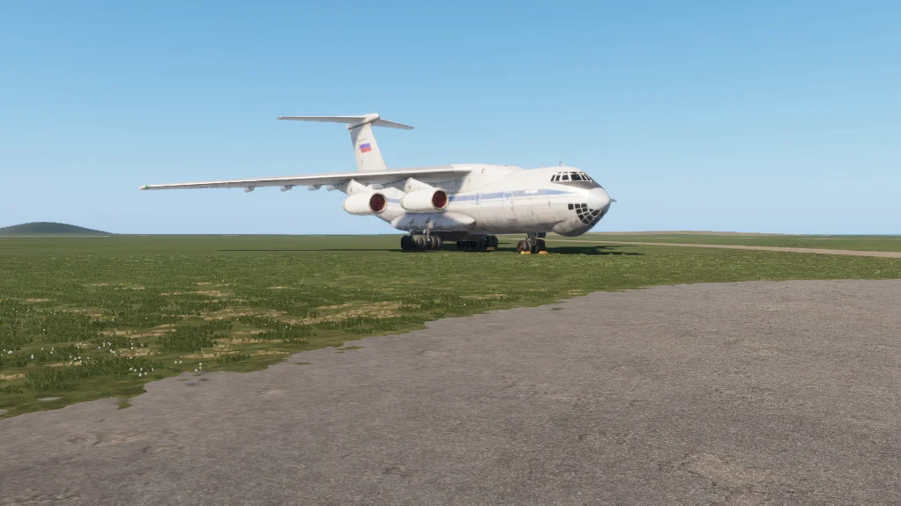

# Il-76


First listed in the **0.2** changelog.


<figure><figcaption>
Il-76 in RU markings
</figcaption></figure>

The Il-76 is a Soviet and Russian four-engine transport aircraft. RHS adds it as a static object for missions, in RU, USSR and UN markings. One UN version has running engines.

## Specifications

| Category | Data |
| --- | --- |
| Name in game | IL-76 UN (Running Engines) |

## Variants

The item is available in these versions:

* IL-76 UN (Running Engines)
* IL-76 RU
* IL-76 UN
* IL-76 USSR

## Prefabs


Use these prefabs in Workbench or in your own mission/mod.


| Prefab | Description |
| --- | --- |
| `{D07CF2BBE2B20B2E}Prefabs/Vehicles/Airplanes/IL76/Plane_IL76RU_SupplyDrop.et` | IL-76 UN (Running Engines) |
| `{FD598E08BF17996A}Prefabs/Vehicles/Airplanes/IL76/Plane_IL76RU_running.et` | IL-76 UN (Running Engines) |
| `{64830926F6CF3877}Prefabs/Vehicles/Airplanes/IL76/Plane_IL76UN_running.et` | IL-76 UN (Running Engines) |
| `{7D7B50995A8B3F73}Prefabs/Vehicles/Airplanes/IL76/Plane_IL76_RU_static.et` | IL-76 RU |
| `{427DA89457B921DB}Prefabs/Vehicles/Airplanes/IL76/Plane_IL76_UN_static.et` | IL-76 UN |
| `{522DEDD6E6C0E6C4}Prefabs/Vehicles/Airplanes/IL76/Plane_IL76_USSR_static.et` | IL-76 USSR |
| `{EB610025D1631E00}Prefabs/Vehicles/Airplanes/IL76/Plane_IL76_base.et` | Variant or base prefab |
| `{9166F22E41B67EFE}Prefabs/Vehicles/Airplanes/IL76/Subpart_IL76_base.et` | Variant or base prefab |
| `{5D72B4EE6021B81C}Prefabs/Vehicles/Airplanes/IL76/countermeasures_il76.et` | Variant or base prefab |
| `{E6CF4F6D944AE371}Prefabs/Vehicles/Airplanes/IL76/decal_il76_rus.et` | Variant or base prefab |
| `{5F5679360B213EFA}Prefabs/Vehicles/Airplanes/IL76/decal_il76_un.et` | Variant or base prefab |
| `{28187D20E23B7772}Prefabs/Vehicles/Airplanes/IL76/decal_il76_ussr.et` | Variant or base prefab |
| `{DF5A4DEAB6600B2D}Prefabs/Vehicles/Airplanes/IL76/il76_fake.et` | Variant or base prefab |
| `{EBF5CCD68C3F3C26}Prefabs/Vehicles/Airplanes/IL76/parking_stuff_il76.et` | Variant or base prefab |
