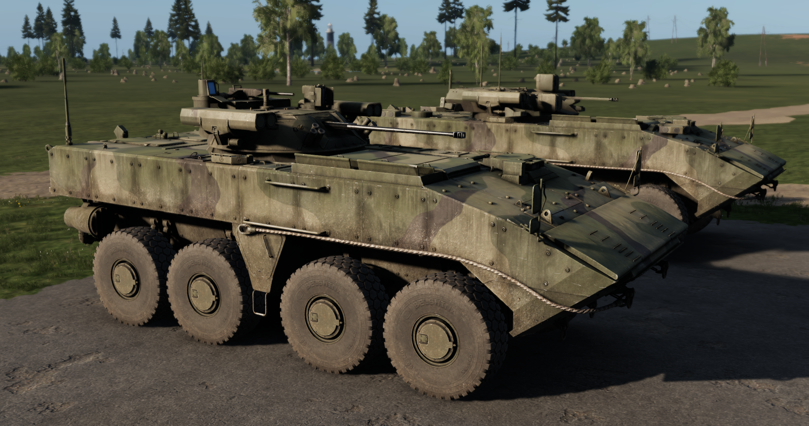

# K-17 Boomerang


Introduced in **0.2.414**


<figure><figcaption></figcaption></figure>


In version 0.4.1149 K-17 Hud was remade from scratch, here is a small guide how to use it.


<figure><figcaption>
K-17 Hud
</figcaption></figure>

The K-17 'Bumerang' is a Russian-made wheeled infantry fighting vehicle first revealed in 2011, intended to transport troops and provide protection against small arms fire, shrapnel, and mine blasts.

## Specifications

| Category | Data |
| --- | --- |
| Name in game | K-17 'Berezok' |

## Variants

The item is available in these versions:

* K-17 'Berezok'
* K-17 'Berezok' (Camo)
* K-17 'Berezok' (Tan)
* K-17 'Epoch'
* K-17 'Epoch' (Camo)
* K-17 'Epoch' (Expo camo)
* K-17 'Epoch' (Tan)
* K-17 'Bumerang'
* VPK-7829 'Bumerang'
* VPK-7829 'Bumerang' (Camo)
* VPK-7829 'Bumerang' (Expo camo)
* VPK-7829 'Bumerang' (Tan)

## Prefabs


Use these prefabs in Workbench or in your own mission/mod.


| Prefab | Description |
| --- | --- |
| `{31F0866273C46D76}Prefabs/Vehicles/Wheeled/K17/APC_K17_Berezok.et` | K-17 'Berezok' |
| `{DD0CB0331A3D8CA7}Prefabs/Vehicles/Wheeled/K17/APC_K17_Berezok_camo1.et` | K-17 'Berezok' (Camo) |
| `{944D59BF5EC046D6}Prefabs/Vehicles/Wheeled/K17/APC_K17_Berezok_tan.et` | K-17 'Berezok' (Tan) |
| `{F86AB1BD36B33407}Prefabs/Vehicles/Wheeled/K17/APC_K17_Epoch.et` | K-17 'Epoch' |
| `{3918E80DF5393F8C}Prefabs/Vehicles/Wheeled/K17/APC_K17_Epoch_camo1.et` | K-17 'Epoch' (Camo) |
| `{3CFCB80B822033CF}Prefabs/Vehicles/Wheeled/K17/APC_K17_Epoch_camoExpo.et` | K-17 'Epoch' (Expo camo) |
| `{295A6AAFBE74C040}Prefabs/Vehicles/Wheeled/K17/APC_K17_Epoch_tan.et` | K-17 'Epoch' (Tan) |
| `{137518B322EAA4D6}Prefabs/Vehicles/Wheeled/K17/APC_K17_Kord.et` | K-17 'Bumerang' |
| `{8C271634056DAD5A}Prefabs/Vehicles/Wheeled/K17/APC_K17_base.et` | K-17 'Bumerang' |
| `{3B899AC9449C35F0}Prefabs/Vehicles/Wheeled/K17/APC_K17_unarmed.et` | VPK-7829 'Bumerang' |
| `{DC6A0BC75B198106}Prefabs/Vehicles/Wheeled/K17/APC_K17_unarmed_camo1.et` | VPK-7829 'Bumerang' (Camo) |
| `{DD20465C217BB8BF}Prefabs/Vehicles/Wheeled/K17/APC_K17_unarmed_camoExpo.et` | VPK-7829 'Bumerang' (Expo camo) |
| `{0C139EE580E03990}Prefabs/Vehicles/Wheeled/K17/APC_K17_unarmed_tan.et` | VPK-7829 'Bumerang' (Tan) |
