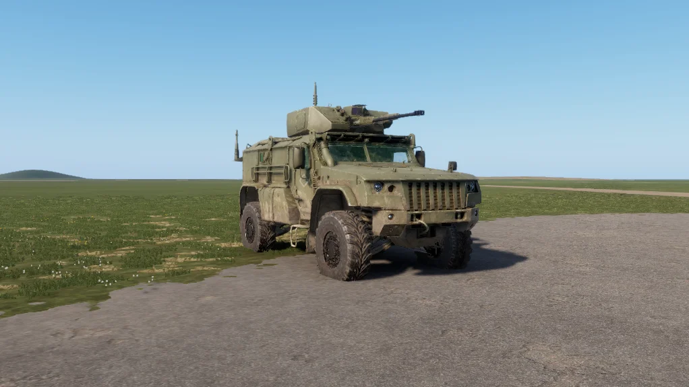

# K-4386 Typhoon-VDV


First listed in the **0.10** changelog.


<figure><figcaption>
K-4386 with remote weapon station
</figcaption></figure>

The K-4386 'Typhoon-VDV' is a 4×4 mine-protected armored vehicle developed by Kamaz for Russian Airborne Forces, designed to be air-droppable and capable of independent operation after landing. Armed with a 30mm 2A42 autocannon in a remote-controlled weapon station.

## Specifications

| Category | Data |
| --- | --- |
| Name in game | K-4386 'Typhoon-VDV' |

## Prefabs


Use these prefabs in Workbench or in your own mission/mod.


| Prefab | Description |
| --- | --- |
| `{A61E5C16E9A2161A}Prefabs/Vehicles/Wheeled/K4386/K4386.et` | Trunk |
| `{AB5DE68E3E654FCA}Prefabs/Vehicles/Wheeled/K4386/K4386_Armed.et` | Trunk |
| `{1DF4C30C130D8FAD}Prefabs/Vehicles/Wheeled/K4386/K4386_Armed_Camo.et` | Trunk |
| `{E836092AB606CE4A}Prefabs/Vehicles/Wheeled/K4386/K4386_Armed_Tan.et` | Trunk |
| `{863A65C2E3330F2F}Prefabs/Vehicles/Wheeled/K4386/K4386_Base.et` | Trunk |
| `{9BF596A3464B6DB8}Prefabs/Vehicles/Wheeled/K4386/K4386_Camo.et` | Trunk |
| `{A53F4D3BB9DC85D4}Prefabs/Vehicles/Wheeled/K4386/K4386_RG.et` | Trunk |
| `{93953D1ABAEE7D85}Prefabs/Vehicles/Wheeled/K4386/K4386_Tan.et` | Trunk |
