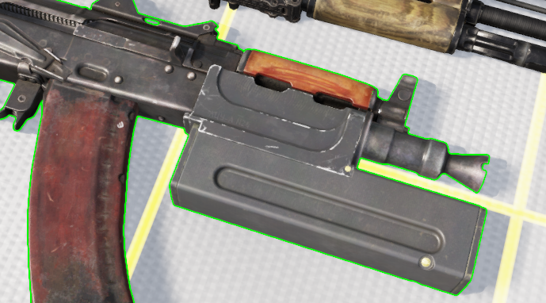

# LTSU-1


Introduced in **0.4.1026**


Laser device that is capable of emitting visible laser of orange color and is mountable on the AKS-74U.

<figure><figcaption></figcaption></figure>

### Default key bind

LTSU only has an option to toggle its visible laser.

Refer to [Default Key Bindings ](../../../../general-systems/default-key-binds.md)section.

## Specifications

| Category | Data |
| --- | --- |
| Name in game | LTsU-A Laser Designator |
| Weight | 650 g |

## Prefabs


Use these prefabs in Workbench or in your own mission/mod.


| Prefab | Description |
| --- | --- |
| `{D98FE847837E0709}Prefabs/Weapons/Attachments/Lasers/aksu_ltsu/Laser_LTSU_base.et` | LTsU-A Laser Designator |
