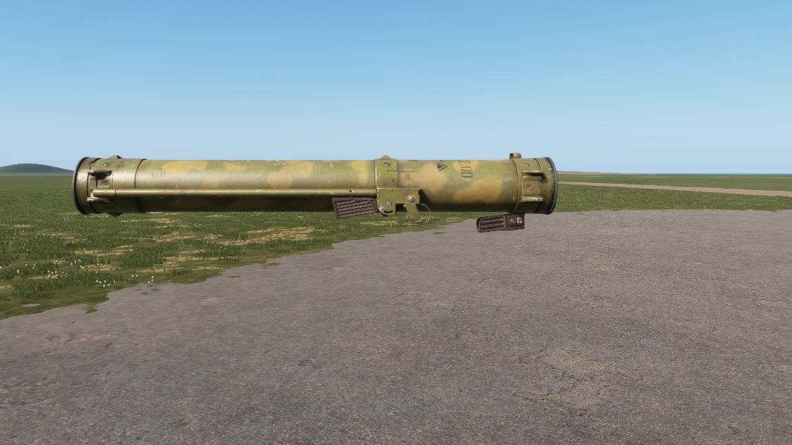

# RPO-A


First listed in the **0.6** changelog.


<figure><figcaption>
RPO-A, side view
</figcaption></figure>

Thermobaric munition. Utilizes enhanced-blast and heat effects to destroy targets.

## Specifications

| Category | Data |
| --- | --- |
| Name in game | RPO-A |
| Weight | 2.5 kg |

## Variants

The item is available in these versions:

* RPO-A
* RPO-D
* RPO Eyecup

## Prefabs


Use these prefabs in Workbench or in your own mission/mod.


| Prefab | Description |
| --- | --- |
| `{3F38EE51E904AE5B}Prefabs/Weapons/Launchers/RPOA/Launcher_RPOA.et` | RPO-A |
| `{D107989BCA4445D7}Prefabs/Weapons/Launchers/RPOA/Launcher_RPOD.et` | RPO-D |
| `{22F71D304C7CCCCC}Prefabs/Weapons/Launchers/RPOA/Launcher_RPO_base.et` | RPO-A |
| `{F683D2CFE73E85FB}Prefabs/Weapons/Launchers/RPOA/RPO_Eyecup.et` | RPO Eyecup |
